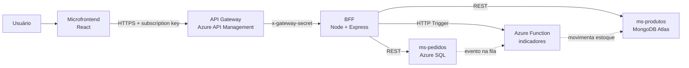

# pjbl-bff — BFF do Conecta Store

Backend for Frontend do nosso projeto PJBL de Arquitetura. É a **única API que o microfrontend conhece**: o front nunca
fala direto com os microserviços. O BFF junta os dados do `ms-produtos` (MongoDB), do `ms-pedidos` (Azure SQL) e da
Azure Function e entrega tudo já no formato que a tela precisa.

Este repositório faz parte de um conjunto de seis:

| Repositório | O que é |
|---|---|
| [pjbl-microfrontend](https://github.com/{{GITHUB_USER}}/pjbl-microfrontend) | Interface (React + Module Federation) |
| **pjbl-bff** (este) | Backend for Frontend (Node + Express) |
| [pjbl-ms-produtos](https://github.com/{{GITHUB_USER}}/pjbl-ms-produtos) | Microserviço de produtos e estoque (MongoDB Atlas) |
| [pjbl-ms-pedidos](https://github.com/{{GITHUB_USER}}/pjbl-ms-pedidos) | Microserviço de pedidos (Azure SQL) + eventos |
| [pjbl-function](https://github.com/{{GITHUB_USER}}/pjbl-function) | Azure Function (HTTP Trigger + Queue Trigger) |
| [pjbl-arquitetura](https://github.com/{{GITHUB_USER}}/pjbl-arquitetura) | ARC42, C4, Canvas, API Gateway e scripts de deploy |

## Na nuvem

| O quê | Link |
|---|---|
| Swagger do BFF | {{URL_BFF}}/docs |
| OpenAPI (JSON) | {{URL_BFF}}/openapi.json |
| Health | {{URL_BFF}}/health |
| API Gateway (entrada oficial) | {{URL_GATEWAY}} |
| Frontend | {{URL_FRONTEND}} |
| Imagem Docker | https://hub.docker.com/r/{{DOCKERHUB_USER}}/pjbl-bff |

> Em produção o BFF só responde para o API Gateway (ver [Segurança](#segurança)). Health e Swagger ficam abertos.

## Arquitetura



O BFF tem três responsabilidades:

1. **Agregação** — `GET /aggregated-data` consulta o `ms-produtos` e o `ms-pedidos` **em paralelo**, envia o resultado
   para a Azure Function calcular os indicadores e devolve **um único JSON**. Se alguma fonte cair, a resposta continua
   saindo (HTTP 200) com `partial: true` e o bloco daquela fonte como `null` — a tela mostra o que deu para buscar.
2. **Orquestração** — em `POST /orders` o front manda só `productId` e `quantity`. O BFF busca os produtos no catálogo,
   usa o **nome e o preço oficiais** (ninguém altera preço pelo navegador), confere o estoque e só então cria o pedido
   no `ms-pedidos`. A baixa do estoque não é feita aqui: ela acontece depois, de forma assíncrona, pelo evento
   `order.created`.
3. **Proxy** — o CRUD de produtos e de pedidos é repassado para os microserviços. Erros 4xx voltam para o front
   exatamente como o microserviço respondeu; se o microserviço estiver fora do ar, o BFF responde 502 (ou 504 em timeout).

### Camadas (Clean Architecture)

```
src/
├── domain/                  regras e tipos puros — nenhum pacote externo
│   ├── errors.ts            ValidationError, DomainError, ConflictError, UpstreamError
│   ├── models.ts            Product, Order, OutboxItem...
│   └── orderDraft.ts        monta os itens do pedido (preço oficial, soma repetidos, confere estoque)
├── application/
│   ├── ports/               interfaces ProductsApi, OrdersApi, IndicatorsApi
│   ├── features/            um diretório por caso de uso (vertical slice)
│   │   ├── GetAggregatedData/
│   │   ├── PlaceOrder/
│   │   ├── ProductsProxy/
│   │   ├── OrdersProxy/
│   │   └── CheckHealth/
│   └── validation.ts
├── infrastructure/          implementação das portas: clientes HTTP (fetch), config, logger
│   └── http/                HttpJsonClient, ProdutosHttpApi, PedidosHttpApi, IndicatorsFunctionApi
├── api/                     Express: um endpoint por feature, middlewares, OpenAPI
│   ├── features/<Feature>/<Feature>Endpoint.ts
│   ├── middlewares/         correlationId, gatewaySecret, errorHandler
│   ├── openapi.ts
│   └── app.ts
└── main.ts                  composition root — único arquivo que conhece infrastructure + api
```

A regra é a de sempre: as dependências apontam para dentro. O `domain` não importa nada; a `application` só conhece o
`domain` e fala com o mundo por meio das portas; `infrastructure` e `api` não se conhecem, quem liga as duas é o `main.ts`.

### Vertical Slice

Cada funcionalidade tem a sua pasta em `application/features/<Feature>/` (schema de validação + classe `<Feature>Handler`)
e o adaptador HTTP correspondente em `api/features/<Feature>/<Feature>Endpoint.ts`. Uma feature não importa código de outra.
Para criar uma funcionalidade nova, a gente cria essas duas pastas e registra o handler no `main.ts` — não precisa mexer
nas features que já existem.

## Tecnologias

- Node.js 22 e TypeScript 5.9
- Express 5
- zod (validação), pino + pino-http (logs em JSON)
- helmet, cors e express-rate-limit (segurança)
- swagger-ui-express (documentação em `/docs`)
- Vitest + Supertest (testes)
- Docker (imagem multi-stage) e GitHub Actions (CI + publicação no Docker Hub)

## Endpoints

| Método | Rota | O que faz |
|---|---|---|
| GET | `/aggregated-data` | **Endpoint obrigatório.** Produtos + pedidos + eventos recentes + indicadores da Function, em um JSON só |
| POST | `/orders` | Cria pedido (orquestrado: catálogo → estoque → ms-pedidos) |
| GET | `/orders`, `/orders/:id` | Lista / detalha pedidos |
| PUT | `/orders/:id` | Edita dados do cliente (só pedido PENDENTE) |
| PATCH | `/orders/:id/status` | Muda o status (PAGO, ENVIADO, ENTREGUE, CANCELADO) |
| DELETE | `/orders/:id` | Exclui pedido (só CANCELADO) |
| GET / POST | `/products` | Lista / cadastra produtos |
| GET / PUT / DELETE | `/products/:id` | Detalha / edita / exclui produto |
| GET / POST | `/products/:id/stock-movements` | Histórico / entrada ou saída manual de estoque |
| GET | `/events` | Eventos de pedido (outbox do ms-pedidos) com status PUBLICADO, PENDENTE ou FALHOU |
| GET | `/health` | Saúde do BFF e de cada dependência |
| GET | `/docs`, `/openapi.json` | Swagger UI e especificação OpenAPI 3 |

Exemplo (resumido) da resposta do `/aggregated-data`:

```json
{
  "generatedAt": "2026-11-10T13:10:00.180Z",
  "correlationId": "0b0f3c0e-6c1f-4f5e-9f4e-2f6f1d6f9a11",
  "partial": false,
  "totalDurationMs": 180,
  "products": { "items": [ ... ], "total": 8 },
  "orders": { "items": [ ... ], "total": 5 },
  "recentEvents": [ ... ],
  "indicators": { "orders": { "revenue": 300, "averageTicket": 100 }, "alerts": ["..."], "computedBy": "azure-function" },
  "sources": {
    "msProdutos": { "status": "ok", "durationMs": 40 },
    "msPedidos": { "status": "ok", "durationMs": 55 },
    "azureFunction": { "status": "ok", "durationMs": 90 }
  }
}
```

A resposta também leva o cabeçalho `Server-Timing` (`ms-produtos;dur=40, ms-pedidos;dur=55, azure-function;dur=90, total;dur=180`),
que aparece na aba **Network → Timing** do navegador. Foi o jeito que encontramos de mostrar, sem abrir log nenhum, quanto
tempo cada serviço levou.

### Erros

Todo erro sai no mesmo formato:

```json
{ "error": { "code": "INSUFFICIENT_STOCK", "message": "Estoque insuficiente para um ou mais itens do pedido.",
             "details": [{ "productId": "...", "productName": "Café 500g", "requested": 20, "available": 12 }],
             "correlationId": "..." } }
```

| HTTP | Quando |
|---|---|
| 400 | `VALIDATION_ERROR` (com a lista de campos) ou `INVALID_JSON` |
| 401 | `UNAUTHORIZED` — chamada não veio pelo API Gateway |
| 404 / 409 / 422 | regra de negócio do BFF ou erro repassado do microserviço |
| 429 | `RATE_LIMITED` |
| 502 | `UPSTREAM_UNAVAILABLE` — microserviço fora do ar ou com erro 5xx |
| 504 | `UPSTREAM_TIMEOUT` |

### Rastreabilidade

Toda requisição ganha um `x-correlation-id` (ou reaproveita o que veio). O mesmo id é enviado para os microserviços e
para a Function, e também vai dentro do evento do pedido. Procurando por ele nos logs dá para seguir uma chamada do
front até o banco.

## Segurança

- **Entrada só pelo gateway:** com `GATEWAY_SECRET` definido, o BFF recusa (401) qualquer chamada sem o cabeçalho
  `x-gateway-secret` correto. Quem coloca esse cabeçalho é a policy do API Gateway, então conhecer a URL do BFF não basta.
- **Chaves internas:** o BFF se identifica para os microserviços com `x-api-key` e para a Function com `x-functions-key`.
  Se uma dessas chaves estiver errada o cliente recebe 502, não 401 (o problema é nosso, não de quem chamou).
- helmet, CORS com lista de origens, rate limit e limite de 100 kB no corpo.
- Segredos só por variável de ambiente; cabeçalhos sensíveis são mascarados no log.

## Variáveis de ambiente

| Variável | Padrão | Para que serve |
|---|---|---|
| `PORT` | `3000` | Porta HTTP |
| `PRODUTOS_API_URL` | `http://localhost:3001` | URL do ms-produtos |
| `PRODUTOS_API_KEY` | — | Chave interna do ms-produtos (`x-api-key`) |
| `PEDIDOS_API_URL` | `http://localhost:3002` | URL do ms-pedidos |
| `PEDIDOS_API_KEY` | — | Chave interna do ms-pedidos |
| `FUNCTION_URL` | — | URL da Function App com `/api`. Vazio = Function "skipped" |
| `FUNCTION_KEY` | — | Function key do HTTP Trigger |
| `GATEWAY_SECRET` | — | Se definido, exige `x-gateway-secret` |
| `GATEWAY_URL` | — | URL do gateway (aparece como servidor no Swagger) |
| `CORS_ORIGIN` | `*` | Origens liberadas, separadas por vírgula |
| `RATE_LIMIT_PER_MINUTE` | `300` | Limite de requisições por minuto por IP |
| `UPSTREAM_TIMEOUT_MS` | `10000` | Tempo máximo de espera por um serviço de trás |
| `LOG_LEVEL` | `info` | Nível do log |
| `PUBLIC_URL` | — | URL pública do BFF (aparece no Swagger) |

## Como rodar localmente

Precisa de Node 22 ou mais novo.

```bash
git clone https://github.com/{{GITHUB_USER}}/pjbl-bff.git
cd pjbl-bff
npm install
cp .env.example .env      # no Windows: copy .env.example .env
npm run dev
```

O BFF sobe em http://localhost:3000 e a documentação fica em http://localhost:3000/docs.

Ele depende dos outros serviços para ter o que mostrar. O jeito mais rápido é subir os dois microserviços em modo
memória (sem banco), cada um no seu terminal:

```bash
# terminal 1 — ms-produtos na porta 3001
cd ../pjbl-ms-produtos && npm install && npm run dev

# terminal 2 — ms-pedidos na porta 3002
cd ../pjbl-ms-pedidos && npm install && npm run dev
```

Sem `FUNCTION_URL` o `/aggregated-data` funciona, só que com a Function marcada como `skipped`. Para rodar a Function
local (Azure Functions Core Tools + Azurite) veja o README do `pjbl-function` e aponte
`FUNCTION_URL=http://localhost:7071/api`.

Se quiser subir tudo de uma vez com Docker, o `docker-compose.yml` está no repositório `pjbl-arquitetura`.

## Testes

```bash
npm test             # tudo: unitários, integração e arquitetura
npm run test:arch    # só os testes de arquitetura
npm run typecheck
```

São 96 testes, em três grupos:

- **Unitários** (`tests/unit`) — regras do domínio (`orderDraft`) e casos de uso com fakes das portas: agregação completa,
  resposta parcial, Function com erro ou não configurada, chamadas em paralelo, pedido com preço oficial, estoque insuficiente etc.
- **Integração** (`tests/integration`) — o BFF de verdade (Express + cliente HTTP real) conversando com três servidores
  HTTP falsos que fazem o papel dos microserviços e da Function. Cobre propagação do `x-correlation-id`, repasse de 4xx,
  502/504, gateway secret, CORS, rate limit e confere que toda rota está documentada no OpenAPI.
- **Arquitetura** (`tests/architecture`) — um scanner caseiro lê os imports de `src/` e verifica as regras da Clean
  Architecture e dos vertical slices: domínio sem dependências, application sem framework, API sem importar
  infrastructure, `fetch` só na infrastructure, uma feature não importa outra, toda feature tem Handler e Endpoint.

Para ver um teste de arquitetura falhar, é só quebrar uma regra de propósito. Por exemplo, adicione esta linha em
`src/domain/orderDraft.ts` e rode `npm run test:arch`:

```ts
import express from 'express';
```

O teste "Domain não depende de nenhuma outra camada nem de pacotes externos" acusa o arquivo e o import. (Depois é só apagar a linha.)

## Docker

A imagem é multi-stage (`node:22-alpine`), roda com usuário sem privilégio e tem `HEALTHCHECK`.

```bash
docker build -t {{DOCKERHUB_USER}}/pjbl-bff:v1 .
docker login
docker push {{DOCKERHUB_USER}}/pjbl-bff:v1

# para testar a imagem
docker run --rm -p 3000:3000 --env-file .env {{DOCKERHUB_USER}}/pjbl-bff:v1
```

> O enunciado dá como exemplo `dockerhubuser/pjbl/bff:v1`, mas o Docker Hub não aceita repositório aninhado
> (`usuario/pasta/imagem`). Por isso usamos o nome do projeto como prefixo: `{{DOCKERHUB_USER}}/pjbl-bff:v1`.

No dia a dia ninguém precisa rodar esses comandos: o workflow `.github/workflows/ci.yml` roda os testes e, a cada push
na `main`, publica a imagem com as tags `v1`, `latest` e `sha-<commit>`. Ele usa os secrets `DOCKERHUB_USERNAME` e
`DOCKERHUB_TOKEN` do repositório.

## Alunos

{{ALUNOS}}
